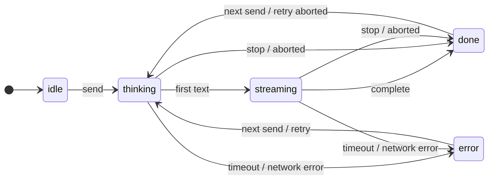

# useChat 状态机设计

> PE 1 设计产物，尚未实现。输入为 `doc/requirements.md`、`doc/architecture-design.md`、`src/components/chat-message.tsx`，补充检查了非功能要求和组件 Story。
>
> 复核修正：初稿擅自增加 `stopped`。本节按已确认的五态契约修订：主动停止进入 `done`，另存结束原因与消息 `aborted` 标记。原始输出和修订 diff 保存在本节视频工作区。

## 1. 流程状态与消息状态

流程状态只描述当前轮次，历史消息不会因为新一轮开始而一起改变状态。

```ts
type ChatFlow = "idle" | "thinking" | "streaming" | "done" | "error"
type MessageStatus = "streaming" | "done" | "error"
type FinishReason = "completed" | "aborted"
```

`done` 表示本轮已结束，可以继续输入；它不保证回答完整。正常完成时 `finishReason = completed`；主动停止时 `finishReason = aborted`，已有助手消息使用 `status = done, aborted = true`。消息状态与完整性标记一起决定 UI，完整回答统计必须检查结束原因。

| 流程状态 | 含义与 UI | 可用操作 |
| --- | --- | --- |
| idle | 初始或新会话，无本轮请求；输入框可用 | 发送、新会话 |
| thinking | 请求已发出，等待首个非空文本；显示独立等待提示，尚无本轮助手消息 | 停止 |
| streaming | 首段文本已到达，助手内容持续追加 | 停止 |
| done | 正常完成或主动停止；后者显示“已中止”，保留已有内容 | 下一轮发送、新会话；中止后可重新生成 |
| error | 请求或输出异常；有内容则保留内容，按阶段提示 | 下一轮发送、新会话、可重试时重试 |

`thinking` 只描述前端等待，不能断言模型正在推理或检索。没有服务端阶段事件时，等待提示使用“正在等待回答”。

流程 `thinking` 与 `streaming` 时禁止重复发送。终态允许编辑并发送新问题。重试入口只针对最近一轮；认证失效等情况先完成恢复条件。

## 2. 状态图

下图覆盖主要路径；`meta`、空文本及逐 token 追加不改变当前状态，见转换表。为便于阅读，清空当前会话另列为独立动作，不把它增加为第六种状态。



## 3. 转换与副作用

| 起点 | 事件 | 终点 | 数据变化与资源处理 |
| --- | --- | --- | --- |
| idle / done / error | send | thinking | 验证输入及知识库；追加一条用户消息；保留历史；清本轮错误和结束原因；分配新 requestId、AbortController 和定时器；请求 `/api/chat` |
| thinking | 首个非空 token / first text | streaming | 创建本轮助手消息并写入首段文本；带入已收到的 grounded；移除等待提示；清首段计时器，开始输出空闲计时 |
| thinking | meta | thinking | 暂存 grounded，不创建空助手消息 |
| thinking | 空文本或保活 | thinking | 忽略，不把它当作首段回答 |
| streaming | 后续 token | streaming | 追加到同一助手消息；重置输出空闲计时；仅在用户贴底时跟随滚动 |
| streaming | meta | streaming | 更新本轮消息 grounded，不改变流程状态 |
| streaming | 服务端 done / complete | done | 消息 status=done、aborted=false；记录 conversationId；结束原因 completed；清计时器与请求资源，恢复输入 |
| thinking / streaming | 用户 stop | done | **先**记录 aborted 结束原因并使本次 requestId 失效，再 abort；清全部计时器；有助手内容则保留并标记 aborted，没有则只显示本轮已中止提示；恢复输入 |
| thinking | 请求失败、首段超时、断网、服务端 error | error | 保存阶段和错误信息；不创建空助手消息；取消请求并清计时器；保留用户问题 |
| streaming | 服务端 error、输出超时、断网、缺少 done 的 EOF | error | 保留已收到的助手内容，消息 status=error；记录阶段和可重试性；清请求与计时器 |
| thinking | 收到 done 但没有非空文本 | error | 记录 EMPTY_ANSWER，避免把空回答标成成功；清请求资源 |
| error / done(aborted) | retry | thinking | 复用最近一轮用户消息，不新增用户问题；移除该轮未完成的助手输出，清错误提示；分配新 requestId 和请求资源，重新生成 |
| 任意状态 | 旧请求的迟到回调 | 不变 | requestId 不匹配或请求已结束则丢弃，防止旧 token、AbortError 和定时器污染新一轮 |

首段文本触发的创建与追加需同一次状态更新提交，避免丢失首段。用户停止引发的 AbortError 不再转入 error；超时主动取消则保留原来的超时错误原因。

`meta` 不是首段文本。当前后端发送自定义 SSE `token/meta/done/error`；网络 chunk 不等于一条事件，协议层必须处理跨 chunk 的事件与一个 chunk 中多条事件。

## 4. 错误按阶段呈现

| 阶段 | 示例 | 内容与提示 | 恢复动作 |
| --- | --- | --- | --- |
| 请求建立前 | HTTP 非成功、连接失败 | 保留用户问题；“发送失败” | 可恢复错误允许重试；认证失败引导重新登录 |
| 等待首段 | 首个非空 token 超时、等待期断网 | 没有助手残答；“等待回答超时”或“网络已断开” | 重试原问题 |
| 输出中 | SSE error、输出空闲超时、断网 | 保留内容；“回答未完成，已保留收到的内容” | 重新生成，不自动续写 |
| 协议结束 | 流关闭但没有 done | 不能把 EOF 当作成功；已有内容标为未完成 | 用户确认后重试 |

HTTP 200 不表示流内业务成功，仍需处理 error 事件、读取异常和异常 EOF。TTFT 指首个回答文本的到达时间，不是 HTTP 首字节时间；3 秒 p95 是性能目标，不能直接作为失败阈值。首段、响应建立、输出空闲的超时阈值需单独配置和验证，不在此臆定为产品已确认值。

## 5. 停止、重试、下一轮与新会话

- **停止**：保留部分内容，使用中性“已中止”提示，不当作网络错误。thinking 阶段停止时没有助手消息，用本轮结束原因展示提示。前端 abort 应沿后端 request.signal 取消上游；这条链路要在实现阶段验证，不能仅凭按钮已变色认定上游停止。
- **重试**：复用同一条用户消息，只替换最近一次未完成的助手输出。保留更早的消息与会话 ID；一次只允许一个请求。默认不自动重试，避免用户不知情地发起重复生成。
- **下一轮发送**：保留全部历史消息，只清本轮状态。继续使用当前 sessionId 和已知 conversationId。更早失败轮次的重试按钮不再可用。
- **新会话 / 清空当前对话**：独立用户动作，不作为发送、停止或重试的附带副作用。本设计只在非请求中允许执行；使 requestId 失效、清理资源和本地消息、重置 conversationId、生成新 sessionId、回到 idle。它不删除数据库审计历史。

后端只将完整回答写入历史，前端保留的残答不因此进入数据库。若服务端已经完成写入而客户端没收到 done，前端无法证明服务端未完成；重试是否造成重复历史或上下文变化，需要后续核对后端幂等契约。这里的“不重复追加问题”保证的是前端消息列表。

## 6. 实现前的检查项

1. 现有 `ChatMessage` 只有 streaming/done/error，需增加 `aborted` 呈现能力及中性提示；保留消息三态。thinking 使用独立占位，不依赖空助手消息。
2. 首段到达时创建助手消息，后续 token 都追加到同一消息；历史消息不跟随当前流程变状态。
3. 所有完成、停止和异常路径统一清理定时器与 controller；requestId 防止旧回调串入新轮次。
4. 错误保留部分内容，按阶段提供文案；clear、retry、send 不混用。
5. PE 1 只生成设计文档。本节没有实现 useChat，也没有接通真实后端。
